<div align="center">

<picture>
  <source media="(prefers-color-scheme: dark)" srcset="docs/readme/hero-dark-en.svg">
  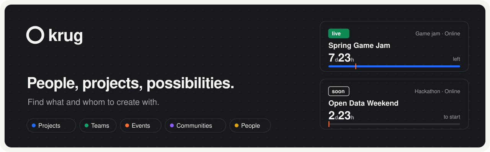
</picture>

<br>

[](https://github.com/wsersigma228/krug/actions/workflows/check.yml)


[](LICENSE)

**English** · [Русский](README.ru.md) · 🚧 Work in progress

</div>

Krug is a web platform to find **what and whom to create with**: projects, independent
teams, events, communities and opted-in people — with open roles, applications and
progress updates. Russian/English, light/dark, desktop and mobile.

<p align="center">
  <picture>
    <source media="(prefers-color-scheme: dark)" srcset="docs/images/discovery-desktop-dark-v3.webp">
    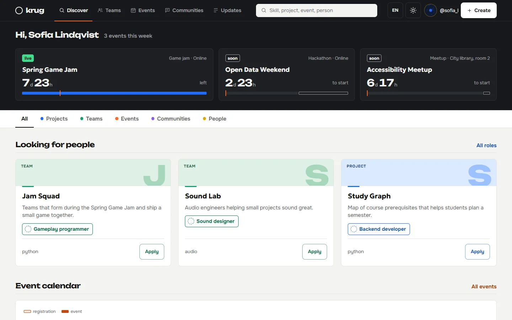
  </picture>
</p>

<table>
<tr>
<td width="50%">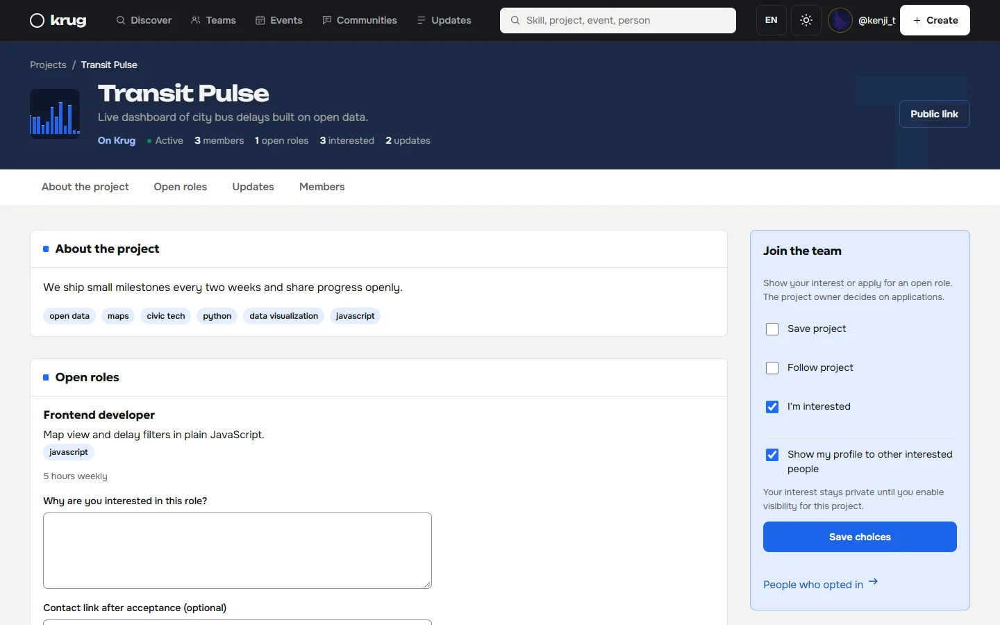</td>
<td width="50%">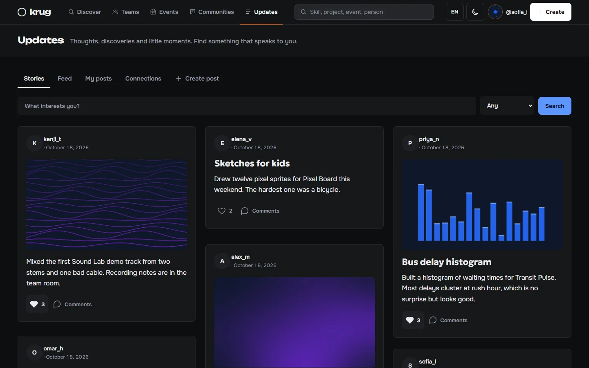</td>
</tr>
<tr>
<td>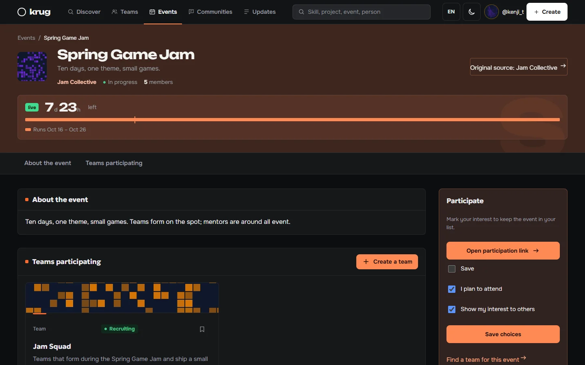</td>
<td>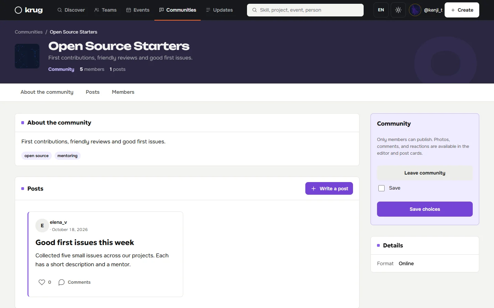</td>
</tr>
</table>

<p align="center">
  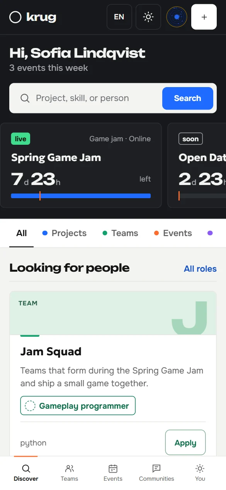&nbsp;
  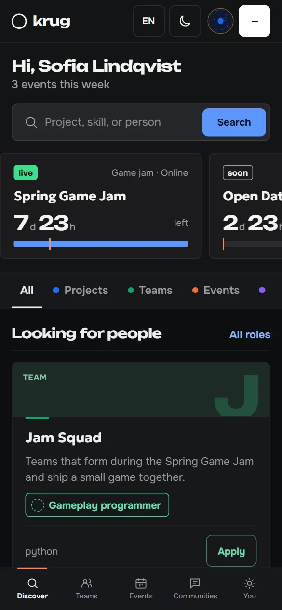&nbsp;
  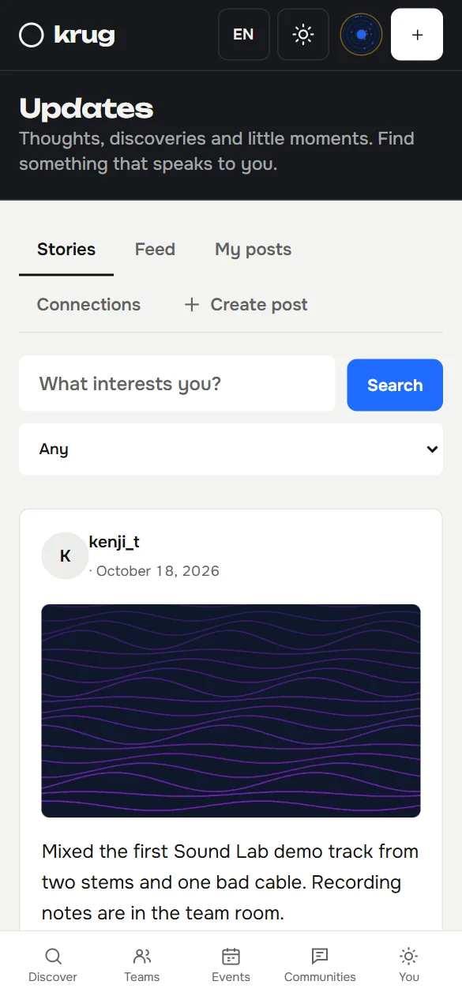&nbsp;
  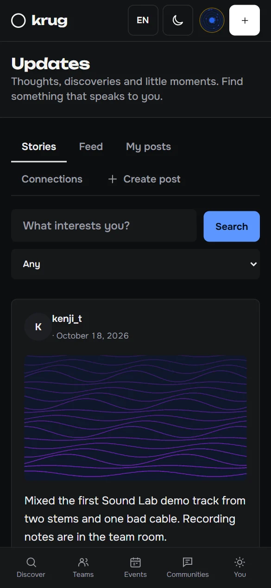
</p>

<p align="center"><sub>Screens from an isolated preview with invented accounts and generated abstract covers, captured 2026-10-18.</sub></p>

## ✨ What's inside

<table>
<tr>
<td width="33%" valign="top">

### 🧭 Discovery
A home with what's on now and soon, an event calendar and open roles.
Projects, people, teams and events in one full-text search with filters;
GitHub refreshes in the background, GitLab by allowlist.

</td>
<td width="33%" valign="top">

### 🤝 Collaboration
Open roles, owner-reviewed applications, teams that grow into projects,
and contacts shared only after acceptance.

</td>
<td width="33%" valign="top">

### 🎪 Communities & events
Join, post and moderate communities. Hackathons, game jams and meetups
with deadlines and participant teams.

</td>
</tr>
<tr>
<td valign="top">

### ✍️ Stories
Drafts, optional titles, one photo per post, likes, flat comments
and a feed of followed authors.

</td>
<td valign="top">

### 🔒 Privacy first
Profiles are discoverable only by consent. Saves and follows stay private.
Email is opt-in; refresh tokens live only in an HttpOnly cookie.

</td>
<td valign="top">

### 🌗 Thoughtful UI
Light, dark and system themes in graphite, blue and orange, RU/EN,
keyboard access, reduced motion and layouts from 320 px to 4K.

</td>
</tr>
</table>

## 🧱 How it fits together

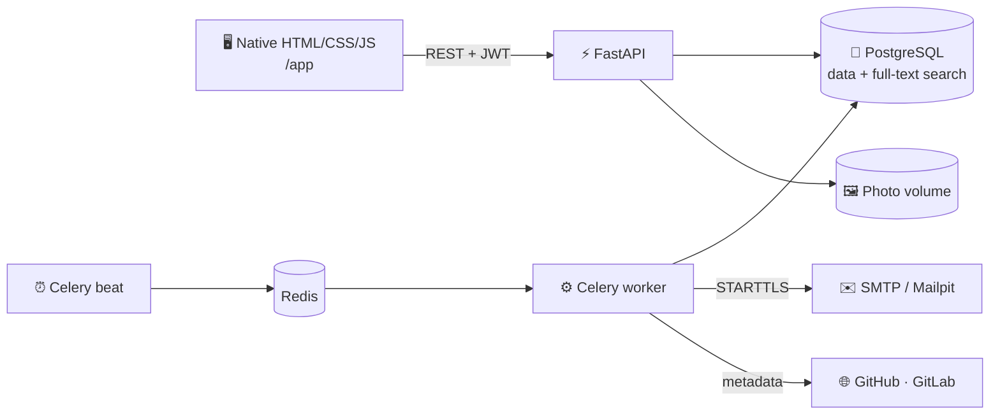

| Layer | Technology |
| --- | --- |
| API | Python 3.14 · FastAPI · Pydantic |
| Data | PostgreSQL 15 · SQLAlchemy · Alembic · native full-text search |
| Background | Celery · Redis · SMTP (Mailpit in development) |
| Interface | Native HTML, CSS and JavaScript — no build step |
| Runtime | Docker Compose or Podman on Linux |

## 🚀 Quick start

Requires Python 3.14 and Docker Compose or Podman on Linux.

```bash
git clone https://github.com/wsersigma228/krug.git && cd krug
python3.14 -m venv .venv
.venv/bin/python -m pip install -r requirements-dev.txt -c constraints.txt
cp .env.example .env          # set SECRET_KEY, DB_PASSWORD and REDIS_PASSWORD
./scripts/start --dev-mail    # build, migrate, start, wait for health
```

| Service | URL |
| --- | --- |
| App | http://localhost:8000/app |
| Swagger | http://localhost:8000/docs |
| Mailpit | http://localhost:8025 |

> [!IMPORTANT]
> Generate unique secrets in `.env`; hexadecimal `DB_PASSWORD` and `REDIS_PASSWORD` avoid URL escaping.
> The launcher keeps database and photo volumes. Never run `down -v` unless you
> intend to delete stored data.

Secrets, local development without containers, and Celery commands:
[setup details](docs/reference.md#setup-details).

## 🧪 Tests

```bash
./scripts/compose up -d db redis
.venv/bin/python -m pytest -q
node scripts/check_i18n.cjs
```

Tests use a separate `test_db`. Browser and smoke checks are described in
[reference](docs/reference.md#tests) and [development](docs/development.md#verification).

## 📚 Documentation

| | Topic |
| --- | --- |
| 📖 | [Reference](docs/reference.md): accounts, mail, pagination, search, photos, scope |
| 🔌 | [API guide](docs/api.md) |
| 🛠️ | [Development and deployment](docs/development.md) |
| 🧭 | [Discovery and import policy](docs/discovery.md) |
| 🔎 | [Search design and query plans](docs/search.md) |
| 🗺️ | [Next: event and recruitment import plan](docs/import-plan.md) (RU) |
| 🎨 | [Design system](DESIGN.md) · [Product scope](PRODUCT.md) · [Security](SECURITY.md) |

## 📌 Status and license

> [!NOTE]
> Krug is a working project in development with no production uptime or scale claim.
> The October 2026 redesign is complete; importing events and recruiting projects is next.
> The access token lives in per-tab sessionStorage, which does not protect against XSS:
> use HTTPS and review your deployment before exposing it. See [security](SECURITY.md)
> and [scope and limits](docs/reference.md#scope-and-license).

[MIT](LICENSE) — the license covers this repository's code, not user-uploaded content.
