<div align="center">

<picture>
  <source media="(prefers-color-scheme: dark)" srcset="docs/readme/hero-dark-ru.svg">
  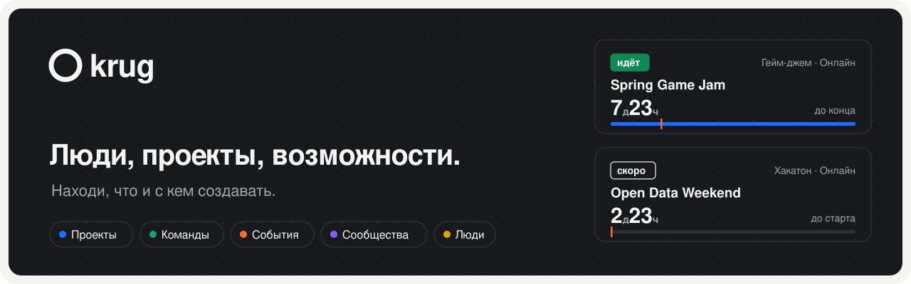
</picture>

<br>

[](https://github.com/wsersigma228/krug/actions/workflows/check.yml)


[](LICENSE)

[English](README.md) · **Русский** · 🚧 В разработке

</div>

Круг — веб-платформа, где находят, **что и с кем создавать**: проекты, самостоятельные
команды, события, сообщества и людей, открывших профиль по согласию. Открытые роли,
заявки и публикации прогресса. RU/EN, светлая/тёмная тема, компьютер и телефон.

<p align="center">
  <picture>
    <source media="(prefers-color-scheme: dark)" srcset="docs/images/discovery-desktop-dark-v2.webp">
    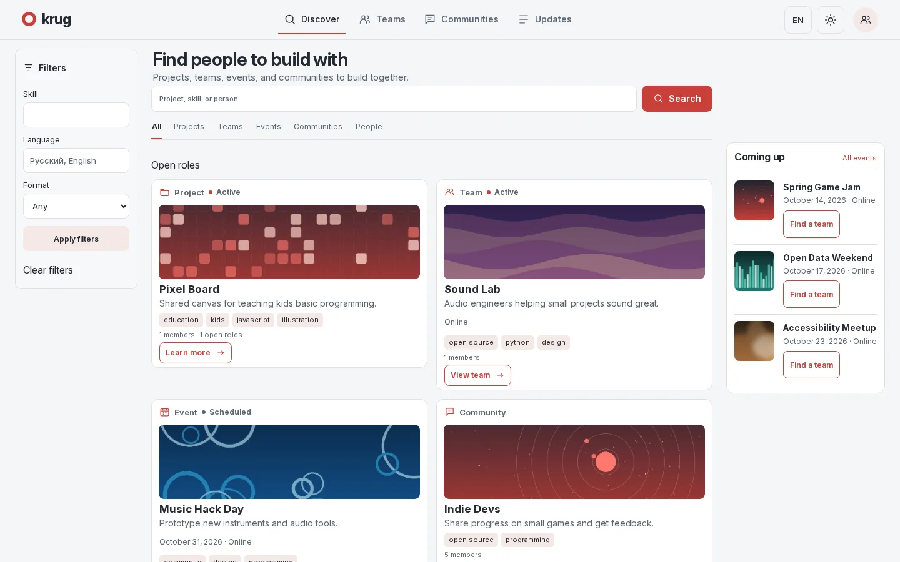
  </picture>
</p>

<table>
<tr>
<td width="50%">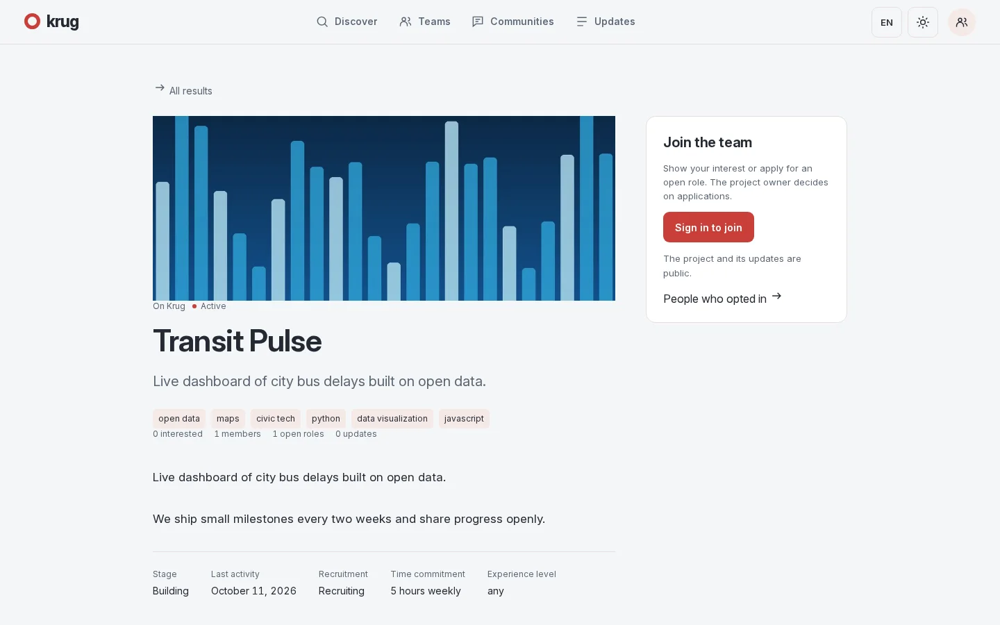</td>
<td width="50%">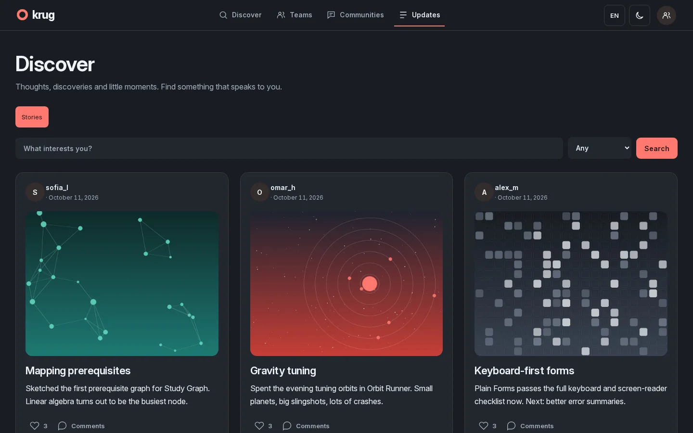</td>
</tr>
<tr>
<td>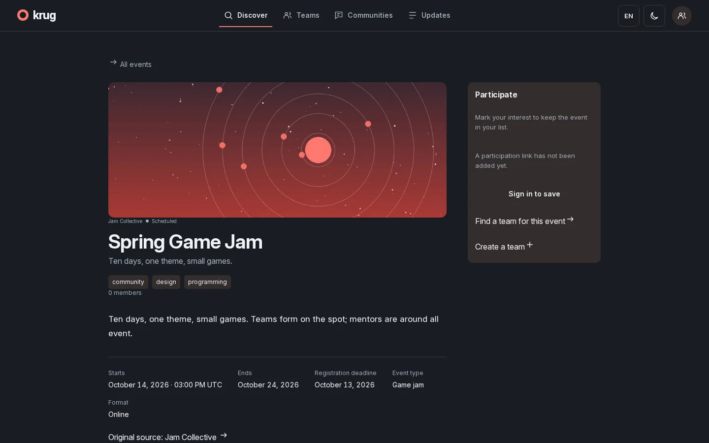</td>
<td>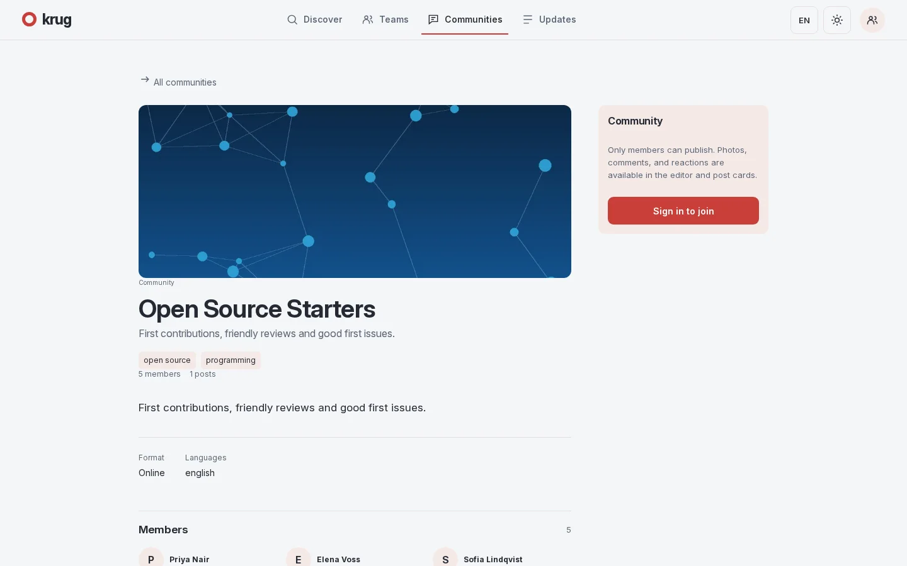</td>
</tr>
</table>

<p align="center">
  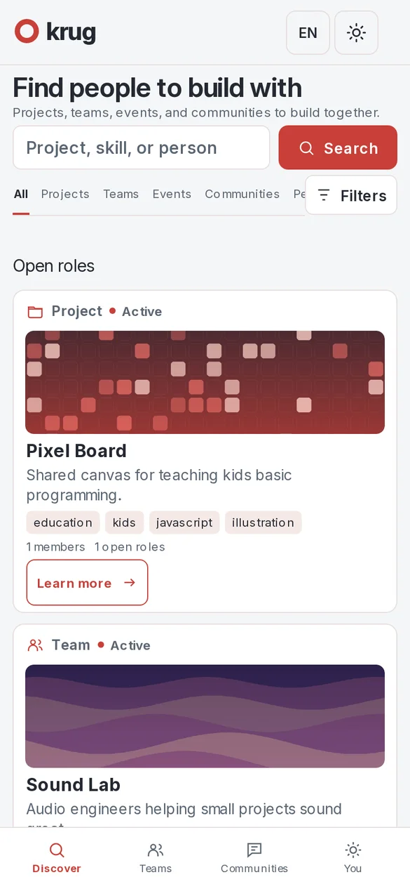&nbsp;
  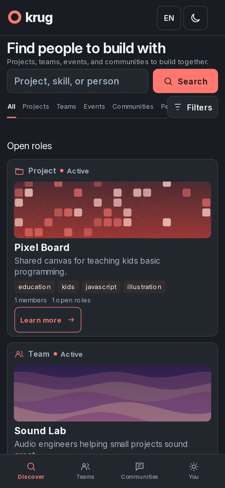&nbsp;
  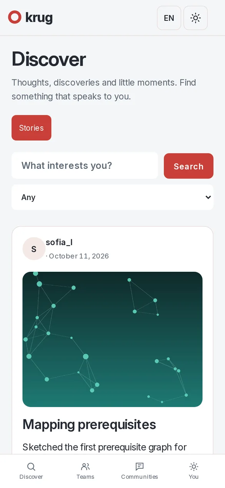&nbsp;
  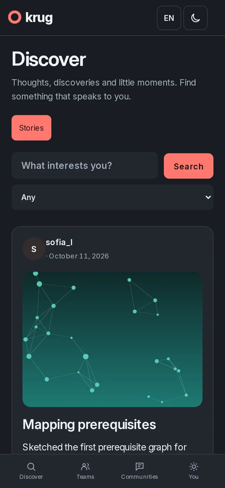
</p>

<p align="center"><sub>Экраны изолированного стенда с вымышленными аккаунтами и сгенерированными абстрактными обложками, снято 11.10.2026.</sub></p>

## ✨ Возможности

<table>
<tr>
<td width="33%" valign="top">

### 🧭 Поиск
Native и внешние проекты, люди, команды, события и роли в одной выдаче
с фильтрами и полнотекстовым поиском. GitHub обновляется в фоне,
GitLab — по явному списку.

</td>
<td width="33%" valign="top">

### 🤝 Совместная работа
Открытые роли, заявки с решением владельца, команды, вырастающие в проекты,
и контакт только после принятия.

</td>
<td width="33%" valign="top">

### 🎪 Сообщества и события
Вступление, публикации и модерация. Хакатоны, гейм-джемы и встречи
со сроками и командами участников.

</td>
</tr>
<tr>
<td valign="top">

### ✍️ Истории
Черновики, необязательные заголовки, фото к записи, лайки,
комментарии и лента подписок.

</td>
<td valign="top">

### 🔒 Приватность
Профиль виден только по согласию. Сохранения и подписки приватны.
Письма — только после явного включения.

</td>
<td valign="top">

### 🌗 Продуманный интерфейс
Коралловая и графитовая темы, RU/EN, клавиатура, reduced motion
и вёрстка от 320 px до 4K.

</td>
</tr>
</table>

## 🧱 Устройство

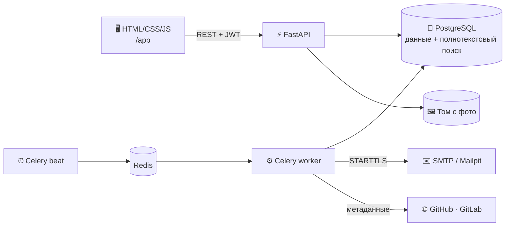

| Часть | Технологии |
| --- | --- |
| API | Python 3.14 · FastAPI · Pydantic |
| Данные | PostgreSQL 15 · SQLAlchemy · Alembic · встроенный полнотекстовый поиск |
| Фоновые задачи | Celery · Redis · SMTP (Mailpit при разработке) |
| Интерфейс | Обычные HTML, CSS и JavaScript, без сборки |
| Выполнение | Docker Compose или Podman на Linux |

## 🚀 Быстрый старт

Нужны Python 3.14 и Docker Compose или Podman на Linux.

```bash
git clone https://github.com/wsersigma228/krug.git && cd krug
python3.14 -m venv .venv
.venv/bin/python -m pip install -r requirements-dev.txt -c constraints.txt
cp .env.example .env          # задай SECRET_KEY и DB_PASSWORD
./scripts/start --dev-mail    # сборка, миграции, запуск, ожидание health
```

| Сервис | Адрес |
| --- | --- |
| Приложение | http://localhost:8000/app |
| Swagger | http://localhost:8000/docs |
| Mailpit | http://localhost:8025 |

> [!IMPORTANT]
> Сгенерируй уникальные секреты в `.env`; шестнадцатеричный `DB_PASSWORD` не требует
> URL-экранирования. Скрипт сохраняет тома БД и фото. Не запускай `down -v`, если
> не собираешься удалить данные.

Секреты, локальная разработка без контейнеров и команды Celery —
в [справочнике](docs/reference.ru.md#запуск-на-linux).

## 🧪 Проверки

```bash
./scripts/compose up -d db redis
.venv/bin/python -m pytest -q
node scripts/check_i18n.cjs
```

Тесты используют отдельную `test_db`. Браузерные и smoke-проверки описаны
в [справочнике](docs/reference.ru.md#проверки) и [development.md](docs/development.md#verification).

## 📚 Документация

| | Тема |
| --- | --- |
| 📖 | [Справочник](docs/reference.ru.md): аккаунт, письма, поиск, проверки, ограничения |
| 🔌 | [API](docs/api.md) |
| 🛠️ | [Разработка и развёртывание](docs/development.md) |
| 🧭 | [Поиск проектов и импорт](docs/discovery.md) |
| 🔎 | [Устройство поиска](docs/search.ru.md) |
| 🎨 | [Дизайн-система](DESIGN.md) · [Продукт](PRODUCT.md) · [Безопасность](SECURITY.md) |

## 📌 Статус и лицензия

> [!NOTE]
> Проект в разработке; заявлений о промышленной надёжности или масштабе нет.
> Токены хранятся в sessionStorage вкладки, это не защищает от XSS: используй HTTPS
> и проверь развёртывание перед публикацией. Подробнее — [ограничения](docs/reference.ru.md#ограничения-и-данные).

[MIT](LICENSE) — лицензия покрывает код репозитория, но не загруженный пользователями контент.
